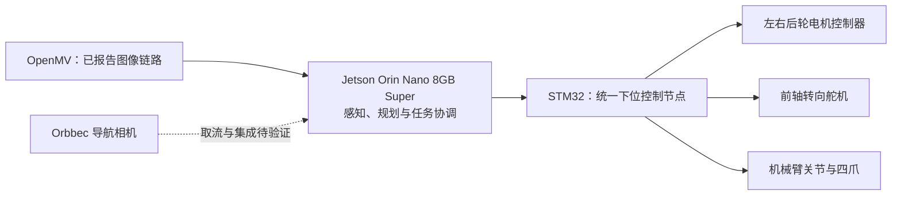

# Autonomous Water-Transport Robot

**面向复杂路面的视觉自主运水机器人 · Autonomous water-transport robot**

本项目代号 AstraGO，是正在开发的课程机器人项目，目标是在混合路面、坡道和障碍环境中，完成敞口水碗的识别、自动夹取、自主运输和定点放置。运输期间，机械臂持续夹持碗，不使用车载碗托。

本仓库于 **2026-11-02** 整理，收录第二版机械文件、阶段汇报、原始照片、设计计算和已有工具。同日补入 Jetson 运行工程、导航仿真、视觉链路、训练工具及软件证据；当前仍不能直接启动整车自主任务。


*上图是先前 P5 使用的 CAD 布置参考，不代表本次第二版总装已完成依赖检查，也不能用来确认 650 mm 版的实际尺寸。*

## Jetson 运行工程（2026-11-02 新增）

代码位于 [software/jetson/](software/jetson/START_HERE.md)，保留原工程结构。已补三色循迹主导航与无标线备用、道路 RGB-D 感知、OpenMV 碗识别/机械臂跟随、训练/标注工具和无硬件仿真。

```bash
cd software/jetson
python3 -m sim.line_free_cart.run --backup-only
python3 sim/bowl_transport/preflight.py
```

完整循迹套件的 NumPy/OpenCV 环境与设备入口见 [运行说明](software/jetson/START_HERE.md)。[仿真](simulation/README.md)、[模型索引](models/README.md)、[数据说明](data/README.md) 和 [测试证据](results/README.md) 已补；权重、原始数据与 bag 不随源码上传。

道路模型既有独立测试为 2,095 张，排除水类别后的六类 mIoU 为 79.62%，铺装 IoU 为 94.41%；这些是离线结果。循迹主方案、无标线备用和抓放监督器已具备软件实现，真实底盘协议/反馈、装车外参、自动抓放、整车避障与满水运输仍待联调。详情及与旧资料的差异见 [本次接入记录](docs/runtime-import-20261102.md)。

## 已有进展（机械与历史团队记录）

| 内容 | 已有记录 | 证据边界 |
| --- | --- | --- |
| 碗识别 | 自采 500 多张图片，微调 YOLO11n-seg | 团队报告；原始数据、训练代码、权重和指标待补 |
| 视觉跟踪 | OpenMV → Orin Nano → STM32，机械臂跟踪移动黑色圆碗 | 已有台架照片及团队报告；不等于三维定位或自动抓取完成 |
| 电机控制 | STM32 实现启停、正反转、调速、实际转速回读 | 独立调试记录；转向、上位机到底盘链路及速度闭环待核实 |
| 机械结构 | P5 记录确认车架已装配；本次收到第二版总装和机械臂配件 | 未在 SolidWorks 中重建；整车装配状态需新照片确认 |
| 四爪夹具 | 已加工，有实物照片；团队修改机械臂安装接口 | 基于供应商设计；安装、开合和载荷测试待补证据 |
| 设计计算 | 型材与亚克力板质量对比、弹簧初选 | 计算估算，详见 [机械说明](docs/mechanical-design.md) |

完整状态见 [项目状态](docs/project-status.md)。自动抓取、自主导航、整车避障、载水速度和 Sim-to-Real 均未作为已验证成果发布。

## 系统分工



这是功能分工图，部分链路仍待联调。协议、板卡资源与反馈状态见 [控制架构](docs/architecture.md)。ROS 相机/感知实现与本机算法仿真已补入；Isaac 完整机器人与物理液体仍待验证。

## 仓库导航

| 目录 | 内容 |
| --- | --- |
| [docs/](docs/README.md) | 状态、约束、架构、设计计算、缺件清单、跨机器上传说明 |
| [hardware/cad/v2/](hardware/cad/v2/README.md) | 第二版总装、原始配件 ZIP、解压零件、文件校验清单 |
| [hardware/](hardware/README.md) | 硬件清单与待确认的电气接口 |
| [assets/images/](assets/images/README.md) | 已有 CAD 参考图、视觉台架及夹具实物照片 |
| [reports/](reports/README.md) | P1–P5 各阶段选定汇报及讲稿，保留历史状态 |
| [software/](software/README.md) | Jetson 完整运行工程、视觉、感知、导航、训练与配置 |
| [firmware/](firmware/README.md) | 待补：STM32 工程和通信定义 |
| [simulation/](simulation/README.md) | 已有导航仿真与抓放流程审计；完整关节/动力学资产待补 |
| [models/](models/README.md)、[data/](data/README.md) | 实际模型大小/哈希、数据划分与训练复现说明；不含二进制 |
| [results/](results/README.md) | 软件测试、原有训练评估与仿真记录；实车动态证据仍待补 |
| [tools/check_jetson_env.py](tools/check_jetson_env.py) | 已有的 Jetson 软件环境盘点脚本 |
