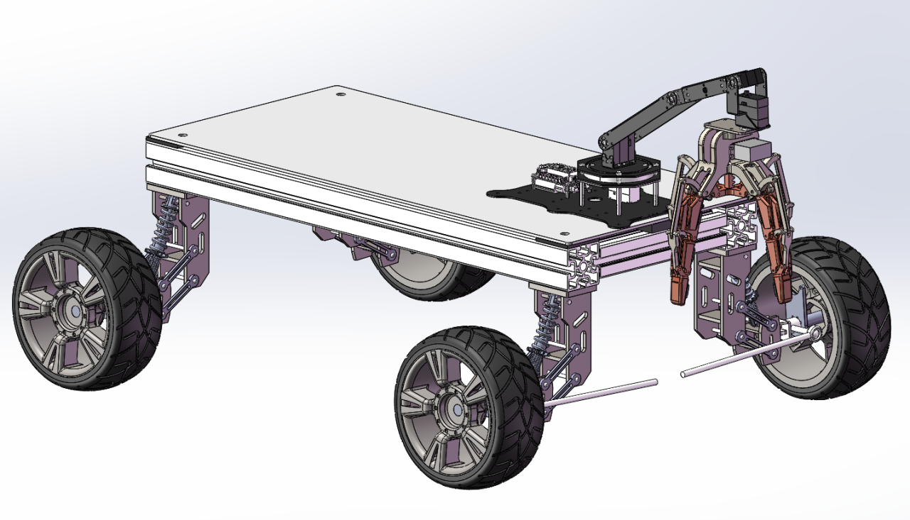
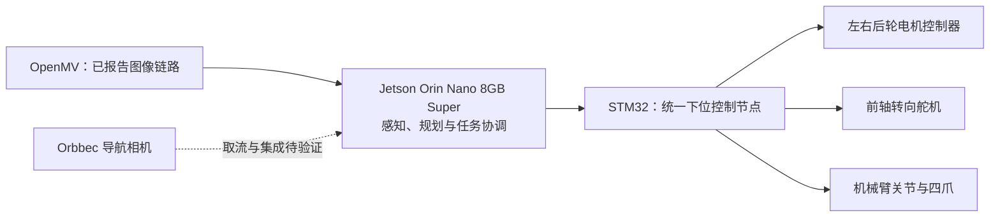

# AstraGO

**面向复杂路面的视觉自主运水机器人 · Autonomous water-transport robot**

AstraGO 是正在开发的课程机器人项目，目标是在混合路面、坡道和障碍环境中，完成敞口水碗的识别、自动夹取、自主运输和定点放置。运输期间，机械臂持续夹持碗，不使用车载碗托。

本仓库于 **2026-11-02** 整理，收录第二版机械文件、阶段汇报、原始照片、设计计算和已有工具。运行代码将由另一台机器补充；当前仓库尚不能启动整车任务。



*上图是先前 P5 使用的 CAD 布置参考，不代表本次第二版总装已完成依赖检查，也不能用来确认 650 mm 版的实际尺寸。*

## 已有进展

| 内容 | 已有记录 | 证据边界 |
| --- | --- | --- |
| 碗识别 | 自采 500 多张图片，微调 YOLO11n-seg | 团队报告；原始数据、训练代码、权重和指标待补 |
| 视觉跟踪 | OpenMV → Orin Nano → STM32，机械臂跟踪移动黑色圆碗 | 已有台架照片及团队报告；不等于三维定位或自动抓取完成 |
| 电机控制 | STM32 实现启停、正反转、调速、实际转速回读 | 独立调试记录；转向、上位机到底盘链路及速度闭环待核实 |
| 机械结构 | P5 记录确认车架已装配；本次收到第二版总装和机械臂配件 | 未在 SolidWorks 中重建；整车装配状态需新照片确认 |
| 四爪夹具 | 已加工，有实物照片；团队修改机械臂安装接口 | 基于供应商设计；安装、开合和载荷测试待补证据 |
| 设计计算 | 型材与亚克力板质量对比、弹簧初选 | 计算估算，详见 [机械说明](docs/mechanical-design.md) |

完整状态见 [项目状态](docs/project-status.md)。自动抓取、自主导航、整车避障、载水速度和 Sim-to-Real 均未作为已验证成果发布。

## 系统分工



这是功能分工图，部分链路仍待联调。协议、板卡资源与反馈状态见 [控制架构](docs/architecture.md)。ROS 和 Isaac Lab 是后续集成、仿真方向，运行工程待上传。

## 仓库导航

| 目录 | 内容 |
| --- | --- |
| [docs/](docs/README.md) | 状态、约束、架构、设计计算、缺件清单、跨机器上传说明 |
| [hardware/cad/v2/](hardware/cad/v2/README.md) | 第二版总装、原始配件 ZIP、解压零件、文件校验清单 |
| [hardware/](hardware/README.md) | 硬件清单与待确认的电气接口 |
| [assets/images/](assets/images/README.md) | 已有 CAD 参考图、视觉台架及夹具实物照片 |
| [reports/](reports/README.md) | P1–P5 各阶段选定汇报及讲稿，保留历史状态 |
| [software/](software/README.md) | 待补：Jetson、OpenMV、ROS 和算法代码 |
| [firmware/](firmware/README.md) | 待补：STM32 工程和通信定义 |
| [simulation/](simulation/README.md) | 待补：URDF、Isaac Lab 场景与配置 |
| [models/](models/README.md)、[data/](data/README.md) | 待补：权重索引、数据与训练复现说明 |
| [results/](results/README.md) | 测试证据索引；当前无原始测试日志或视频 |
| [tools/check_jetson_env.py](tools/check_jetson_env.py) | 已有的 Jetson 软件环境盘点脚本 |

## 从另一台机器继续

以下克隆命令用于远端创建并完成首次上传之后。

```bash
git clone https://github.com/Lurk0526/AstraGO.git
cd AstraGO
git switch -c codex/import-runtime-code
```

按 [代码上传指南](docs/upload-code.md) 放入已有工程，保留原目录与构建文件。当前只有环境盘点脚本，不能把目录说明当作实现代码。

在 Jetson 的目标 Python 环境中可运行：

```bash
python3 tools/check_jetson_env.py | tee jetson_check.txt
```

脚本不安装软件、不打开串口、不发送执行器命令；会做小型 CUDA 运算及依赖导入检查。本次只做静态校验，没有在真实 Jetson 上运行。

优先补充材料见 [待补清单](docs/missing-materials.md)。来源及归属见 [材料索引](docs/source-index.md)；仓库尚未选择开源许可证。
