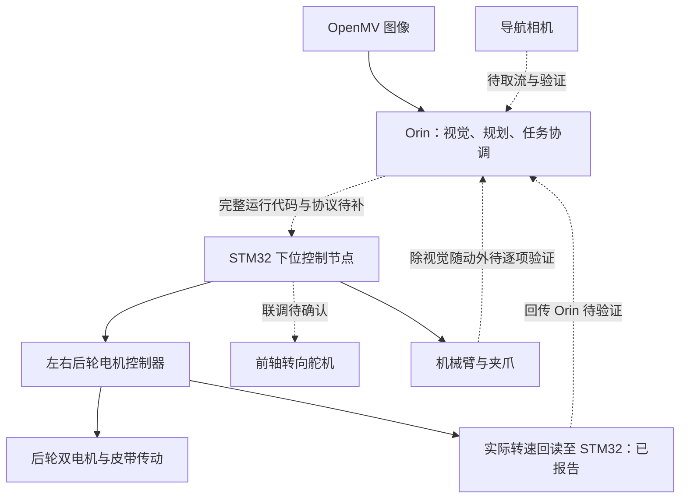

# 控制架构与接口

2026-10-19 用户澄清的功能分工：Orin 接收相机信息并计算，将目标和任务指令交给 STM32；STM32 统一控制电机控制器、转向舵机、机械臂与夹爪。电机控制器就是此前所称底盘控制器，不额外添加一层已存在的“底盘控制板”。

这是目标功能架构，不表示单块现有 STM32 已确认拥有足够接口，也不表示全部链路已联调。

视觉随动已有团队报告，但当前没有代码和命令帧可以确定它如何与统一下位控制工程对应。其他执行器反馈、导航闭环和安全链路都需逐项确认。

| 接口 | 已知 | 上传代码时需补齐 |
| --- | --- | --- |
| OpenMV → Orin | 已报告有图像输入 | OpenMV 程序、传输方式、分辨率、帧率、时间戳 |
| Orin → STM32 | 功能分工已确认 | 串口/CAN 等实际方式、速率、帧定义、单位、校验、超时处理 |
| STM32 → 电机控制器 | 已报告命令和转速回读 | 实际板型、驱动器型号、引脚/总线、速度/转矩模式、反馈语义 |
| STM32 → 转向 | 舵机方案 | PWM/总线类型、中位、限位、正负方向、转角标定 |
| STM32 → 机械臂/夹爪 | 视觉随动已报告 | 厂家协议、真实自由度、零位、关节限位、反馈和停止接口 |
| 供电与急停 | 48 V 电池方向、人工急停计划 | 各设备额定电压、降压路径、保险/开关、断电后夹持和制动行为 |

## 任务流程

接近起点 → 停车 → 识别与定位 → 接近 → 夹紧 → 试提确认 → 持续夹持运输与绕障 → 终点停车 → 放碗并确认释放。

这仍是任务设计。P5 确认的运输姿态是抓取后相对车体保持姿态，尚未实现主动调平、主动减振或抓后自动收臂。
