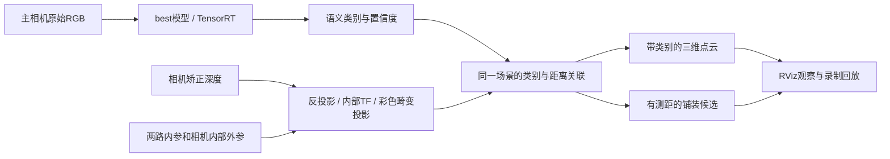

# 道路识别与深度：装车前已完成的感知链路

2026-10-30。适用项目：试验场西北角室外砖路、Gemini MAX、Jetson Orin、ROS 2 Jazzy。用户已说明尚未装到实车，目前按台架调试处理。

## 现在可以怎么用

在项目目录打开终端：

```bash
cd <项目目录>
./open_road_perception.sh
```

这个入口会启动道路感知服务，等待本次进程完成初始化，再打开 RViz。也提供项目根目录的 `道路识别与深度调试.desktop` 启动文件。首次模型加载约需十几秒；相机没有有效画面时，界面仍可打开检查，不把“节点已启动”当成“深度已有效”。

常用操作：

```bash
./road_perception.sh start       # 启动/检查感知服务，不重复启动已有实例
./road_perception.sh status      # 显示当前实例状态，过期状态会标为无效
./road_perception.sh check       # 15秒实时验收并保存图像
./road_perception.sh stop        # 只停止道路感知，保留相机服务
./road_perception.sh restart     # 配置修改后重新加载
./road_perception.sh rviz        # 只打开调试界面
```

相机仍由原有 `gemini-max.service` 管理。道路感知使用用户级临时服务 `water-cart-road-perception.service`，当前登录会话内由 systemd 管理退出和重启；没有额外开启开机自启动。重启电脑后运行上述入口即可。

## 模型已经接入哪里

- 正式模型：`work/models/road/road-4060-v1/model/`，来自完成20轮训练后保存的第8轮 `best`。
- 原始训练包、原始权重和训练日志均保留；部署是独立副本。
- `manifest.json` 固定模型、配置、标签的 SHA256、类别顺序和输入尺寸；损坏或标签不一致时拒绝启动。
- `training-evidence/` 保存训练记录、独立测试结果和此前审计。
- `accelerator/model.onnx`：FP32导出格式检查及数值对比通过。
- `accelerator/model.plan`：在本机 Orin 构建的 TensorRT FP16 engine。8张验证图逐张与 PyTorch FP32 比较，像素分类一致率99.80%～99.99%，均通过记录中的验收阈值；纯前向中位数约8.7ms。
- `backend: auto` 优先加载经过校验且与本机 TensorRT/GPU 匹配的 engine，否则使用 PyTorch CUDA。状态中会显示实际后端；不静默降到CPU。

本次没有继续训练，没有改成RGB-D神经网络。深度由相机测量，随后用几何方法与语义结果对应。

## 数据怎样配合



RGB为640×480，深度为640×400。程序订阅矫正深度，以其投影内参反投影，再使用深度光学坐标到彩色光学坐标的实际TF，以及原始彩色相机的K、D投影到RGB。没有直接按两幅图的相同像素下标拼接。

同一RGB像素存在前后多个深度点时，用最近深度做遮挡检查，避免把背景点贴上前景物体的类别。无效测距、超出0.3～5.0米处理窗口、视野之外或低置信度的位置保留为未知。这里的处理窗口不是已经测定的相机精度范围。

当前调试配置在模型内部旋转180°；模型输出再还原到原始RGB坐标，所以与原始相机内参、深度和TF继续一致。90°、180°、270°的往返还原均已用实际图片检查。最终安装朝向改变后，调整 `input_rotation_degrees`；不要只翻转ROS彩色话题而不处理其他坐标。

## 在RViz里看什么

| 输出 | 意义 |
|---|---|
| `/road_perception/overlay` | 语义叠加；低置信度显示灰色 |
| `/road_perception/mask` | 原始RGB尺寸的类别编号，255表示无效/未知 |
| `/road_perception/confidence` | 最大softmax分数，不是经过现场校准的正确概率 |
| `/road_perception/aligned_depth` | 投影到原始RGB的Z深度，32FC1、米，NaN表示未知 |
| `/road_perception/depth_preview` | 同一深度的距离伪彩色显示，黑色表示未知；用于RViz直观观察 |
| `/road_perception/labeled_points` | 深度光学坐标系下的XYZ、类别颜色、类别编号、置信度 |
| `/road_perception/paved_candidate` | 高置信度铺装外观且有有效测距的候选像素，不是可驾驶空间指令 |
| `/road_perception/obstacle_points` | 只有配置实际车体TF和地面高度后才输出车体障碍点；当前为空 |
| `/road_perception/status` | 输入新鲜度、两路同步、后端、错误、延迟和安装几何状态 |

配色：绿色铺装、棕色松散地面、深绿植被、蓝色水面、红色固定障碍、橙色人车、浅蓝天空。现场预计不涉及水面，模型仍保留原七类输出。

## 已处理的常见问题

- 接收队列保留最新帧，限制最大计算频率；慢帧不导致旧图持续排队。
- 输入在处理前、处理后都核对源时间戳；默认最长源帧年龄0.75秒，两路最大配对差60ms。
- 状态携带 `output_valid_until_stamp`。后续消费者必须检查时间戳和有效状态，不能只看最后一次收到的分类。
- 断流、未来/过期时间戳、缺失内参或TF、无效深度均有明确状态。无效时清空候选与点云；RGB过期时类别图改为255、置信度改为0。
- ROS时间回退时清空输入缓存，避免回放跳转时混用前后的数据。
- 没有深度时RGB识别可以继续，但 `fusion_valid=false`。相机当前对着黑暗/遮挡/超范围场景时，空深度属于需要观察的输入状态，不能强行填成有效。
- `mount.enabled=false`，不生成假设的车体外参，不把地面当障碍物。安装后预备的高度过滤会独立于语义类别检查突起物；具体阈值和斜坡/颠簸适用性需实测。
- 现有节点仅发布图像、点云和诊断，不发布底盘或机械臂运动指令。

## 录制与离线复现

```bash
# 默认录15秒。原始数据约40～60MB/秒，请留出磁盘空间。
./road_perception.sh record --seconds 15

# 用打印出的目录替换下面路径。独立ROS_DOMAIN_ID=83，不混入实时相机。
./road_perception.sh replay work/road_perception/recordings/实际目录 --rviz

# 自动检查回放有效、结束后输出清空
./road_perception.sh replay work/road_perception/recordings/实际目录 --verify
```

录制包含RGB、矫正深度、两路CameraInfo、相机内部静态TF，还保存模型清单和感知配置。程序限定录制时长、检查磁盘余量、采用适配传感器及静态TF的QoS，并使用SIGINT正常关闭bag。没有把大量可重新计算的点云重复写入。

已保存一段6秒台架采集，其中RGB、深度及各自内参各132条、静态TF一条。它用于软件回放验收，不是砖路标注数据。回放遵循 [rosbag2 Jazzy 的录制、QoS与时钟说明](https://github.com/ros2/rosbag2/tree/jazzy#recording-data)。

## 已做的验证与文件

- `tests/test_road_perception.py`：单位、大小端、行填充、投影、畸变、遮挡、无效深度、时间配对、安装高度缺失等几何回归检查。
- `tools/verify_road_deployment.py`：模型旋转还原、标签文件损坏时拒绝加载。
- `tools/test_road_faults.py`：在ROS域84用合成数据检查缺TF、零深度、过期、恢复与断流；不连接实物运动。
- `work/road_perception/fault-tests/result.json`：六阶段故障及恢复结果。
- `work/road_perception/replay-final/check/health.json`：真实台架数据回放、随后失效清空的记录。
- `work/road_perception/final-live-check/health.json`：最新现场输入检查。若当前相机没有有效测距，会如实标为融合不可用。
- `work/road_perception/live/`：当前进程的模型版本、参数、相机内部标定和状态快照。

节点启动与退出已处理ROS上下文和信号；服务只管理本项目感知实例，不抢占相机接口，也不停止原相机服务。

## 装车后才需要做的事

这些信息现在不要求提供，也没有填猜测值：

1. 确定相机最终位置和朝向，记录 `base_link → camera_link` 的实测平移、姿态，以及地面在base_link中的高度；模板为 `config/road-mount-measurements.template.yaml`。
2. 用已知距离的物体检查室外实测距离、RGB/深度边缘对应、无效区域和不同光照；出厂内参投影通过不代表现场测距精度已验收。
3. 填实际轮距/轴距、车身轮廓、转角、里程计和STM32反馈，接入相机与车体统一TF；不重复发布同一条TF。
4. 在实际砖路检查阴影、砖缝、路沿、箱子、行人；根据错例决定是否补标注微调。
5. 最后接入完整导航和低速底盘闭环，实测整链路延迟、刹停距离与转弯能力。模型分数、8.7ms纯前向或30Hz相机均不能直接当作整车速度验收。

当前相机尚未装车，台架画面并非实际砖路。本次完成的是可运行、可复现的感知软件前置工作，不将其记录为整车导航或道路现场验收完成。
