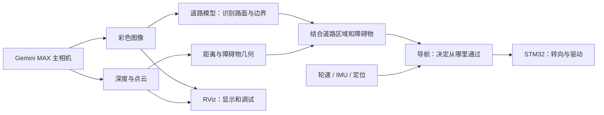

# 自动运水小车：第一次使用 ROS 2

ROS 2 可以理解成小车各个程序之间的消息系统。相机程序、识别程序、导航程序分别工作，通过约定好的消息交换信息。你不必先写出整辆车的软件，也能单独查看和检查某一个部分。

## 先打开已经配置好的界面

双击桌面 **Gemini MAX · RViz 相机调试**。也可以在终端执行：

```bash
cd <项目目录>
./open_gemini_rviz.sh
```

启动器会启动相机服务，再打开 RViz。关闭 RViz 后，相机服务继续运行，重新打开界面不需要重启整套环境。


| 界面内容 | 通俗解释 | 你可以观察什么 |
|---|---|---|
| RGB | 普通彩色照片 | 镜头朝向、清晰度、曝光 |
| Depth - distance | 每个像素的距离图 | 哪些位置测到了距离、哪里没有有效深度 |
| Depth Points | 把距离图展开成三维点 | 墙、桌子、地面等物体的空间轮廓 |
| Obstacle Scan | 从深度图中间一条窄带提取的红点 | 前方这一高度附近有没有障碍物 |
| TF | 相机各个坐标系之间的关系 | RGB 和深度各自朝哪里、彼此位置如何 |
| Grid | 一米一格的空间参考 | 大致距离和比例；当前还不是已标定地面 |

右侧三维视图：左键拖动旋转，中键拖动平移，滚轮缩放。显示某一项太乱时，在左侧 Displays 取消该项勾选。`Global Status: Ok` 表示总体坐标和显示状态正常；某个项目没有收到消息时，展开该项查看具体状态。

点云颜色按相机前向距离变化，属于帮助观察的配色，与模型识别出的“草地、砖路、障碍物”类别无关。红色扫描也不是实体激光雷达，而是相机深度计算出的结果。

当前相机尚未固定，画面可能倾斜或倒置。`Fixed Frame` 设成 `camera_link`，表示以相机为参考观察空间。安装完成后才会增加相机到车身的测量关系，再用车身/地图作为参考。

## 四个经常看到的词

- **节点 Node**：一个干活的程序。例如相机节点读取硬件，分割节点分析照片。
- **话题 Topic**：消息的固定频道。例如 `/camera/color/image_raw` 专门发送彩色图像。
- **消息 Message**：频道里每次发送的具体内容，包括照片、距离、时间戳等。
- **TF**：坐标翻译。例如把“在相机前方两米”换算成“在车体哪个方向”。

一个节点可以发布消息，也可以订阅消息。RViz 订阅相机消息后把它们画出来，因此相机服务一直运行、RViz 随时打开关闭都可以。

## 这辆车的方案怎样配合



第一步是“看见”：主相机提供彩色图和深度。第二步是“看懂”：模型给图片里的区域分类，例如铺装地面、植被、水面、障碍物。第三步是“知道距离”：深度告诉我们物体有多远。第四步是“决定怎么走”：导航结合路线、车宽、转弯能力和当前姿态规划。最后才是由 STM32 执行转向和驱动。

例如一张图里，模型认为中间是铺装路面，但深度发现那里有一个箱子，那么箱子占据的位置应被排除。草地看起来比较平整，也不能仅凭“平整”就作为小车的正常行驶路线。没有识别出类别的新障碍物，也可以通过深度几何发现。

碗定位由另一条视觉链路负责：机械臂相机 → 碗分割 → 几何定位 → 机械臂动作。主摄像头的道路模型和碗模型分别训练，各自解决明确的问题。

## 为什么需要公开数据和训练

预训练模型就像已经上过基础课。公开数据集提供带标准答案的图片，训练是在这些图片上继续练习；验证集用来挑选模型，测试集在模型选定后做最后检查。

道路模型用 SegFormer-B0 做每个像素的分类，碗和常见物体沿用 YOLO11n 系列。公开数据提供启动条件，但照片中的道路、光照、镜头高度与西北角砖路仍有差别。现在先用公开数据建立基线，装车后通过现场观察检验误判和漏判，再决定是否需要补充针对性数据。现阶段无需先准备自采标注集。

当前 RViz 已接入真实相机数据。模型训练和离线预览在独立命令下运行；道路识别结果尚未接入底盘闭环，界面里看到点云并不等于已经完成自动驾驶。

## 只需先记住这些命令

```bash
cd <项目目录>
source ./activate_gemini.sh

# 看有哪些消息频道
ros2 topic list

# 看相机服务是否运行
systemctl --user status gemini-max

# 检查实际图像、点云、扫描帧率和相机内部坐标
/usr/bin/python3 tools/check_gemini_camera.py --seconds 10

# 打开调试界面
./open_gemini_rviz.sh

# 停止或重新启动相机
systemctl --user stop gemini-max
systemctl --user start gemini-max
```

训练使用 `./start_road_training.sh`，具体阶段和配置见 `docs/road-training-plan.md`。训练会占用 GPU 和共享内存，需要快速调试相机时可以先关闭 RViz；关闭窗口只停止显示，不停止相机服务。

官方参考：[ROS 2 Jazzy 入门概念](https://docs.ros.org/en/jazzy/Concepts/Basic.html)、[RViz 使用说明](https://docs.ros.org/en/rolling/Tutorials/Intermediate/RViz/RViz-User-Guide/RViz-User-Guide.html)。
