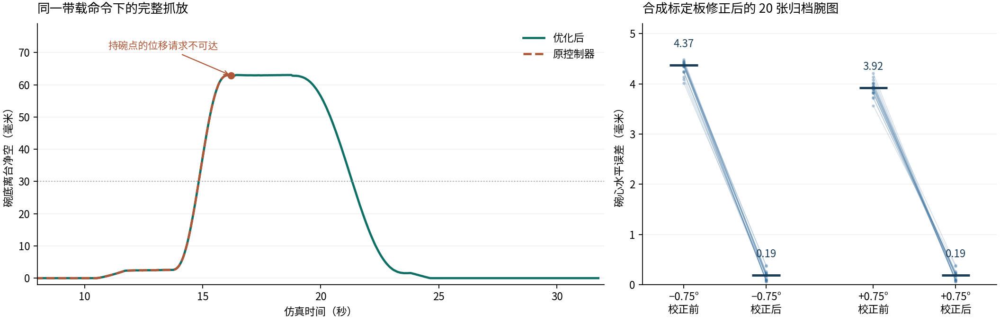

# 650 g 水碗抓放优化与验证

2026-11-20。v4.2 研究候选包含带载位移检查、关节目标平滑和视觉抓位调整。验证统一以碗离台至少 30 mm、保持 2 秒、放回误差不超过 10 mm、松爪后稳定至少 0.5 秒为完成条件。接触、关节、台面承托和闭环约束一起参与验收。本轮物理结果使用 MuJoCo 3.3.7，碗及装水质量按 650 g 计入刚体。

## 带载轨迹

v4.1 修复了闭爪前碗位更新后沿用旧朝向的问题。本轮发现，已可达的名义姿态附近还有一层风险。持碗时请求 1.5–3 mm 平移，可能让全姿态逆运动学超出原误差容限。现在抬升、保持和下降先验证名义目标。额外位移请求不可达时，控制器在每步每轴 1.5 mm 的限制内尝试较小的位移，并记录请求、实际值和被拒绝的误差。名义目标不可达或限速范围内没有可用解时，该次任务继续按失败计。

| 同条件物理对照 | v4.1 | 位移检查改进后 |
| --- | --- | --- |
| 中心停车，零位移 | 完整抓放 | 完整抓放，两版的 636 帧记录一致 |
| 中心停车，保持时半量位移 | 在保持阶段因逆运动学失败停止 | 保持 2.4 秒，完整放回 |
| 中心停车，保持时全量位移 | 在保持阶段因逆运动学失败停止 | 保持 2.4 秒，完整放回 |
| 边界停车，保持时全量位移 | 在保持阶段因逆运动学失败停止 | 保持 2.4 秒，完整放回 |

27 个停车与观测组合的 2,106 组固定端点动作扫描中，逆运动学拒绝从 324 组降到 0 组。每个接受的解都按原位置、朝向与关节边界检查。另外用两个新停车场景测试了带载时变化的位移请求，两例均完成抓放。这里的位移来自固定试验请求，PPO 成绩需要训练和独立评估。

## 抓取高度与相机误差

用 Mac 原档的腕摄估计、停车位和交接关节在 Linux 重放。在 0.50 泡沫摩擦系数、180 ms 命令延迟下，三个停车位共七组条件覆盖原始估计，以及正负横向和高度偏差。视觉路径的抓取高度从观测台面上方 50 mm 改为 48 mm，规划筛选和执行读取同一配置。原高度完成 4/7，改后完成 7/7，三个原失败都是硬指接触，原成功例继续完成。48 mm 来自模型的配对试验，独立机械臂基线仍用 50 mm 方便对比上轮成绩。

仅在计算中注入 ±0.75° 的固定安装角误差，20 个原成功画面的腕摄掩码仍可定位，碗心水平误差中位数却分别升到 3.92 和 4.37 mm。此前比较三张同姿态画面，三帧一致仍会保留这类固定偏差。拟合工具用四个独立合成标定板视角估计变换，在三个不同视角检查，其后重放原来的 20 张掩码。两种误差方向修正后的碗心误差中位数约 0.19 mm，最大约 0.39 mm。合成输入包含像素噪声和测量位置误差。

另取两个归档停车位，把重新计算的碗位、摩擦 0.50、延迟 180 ms、650 g 载荷和持碗时的位移请求放进同一个物理仿真。v4.1 完成 0/2。48 mm 与位移检查加上后，沿用偏移的碗位完成 1/2，余下一例在提起时触发了泡沫力保护。使用拟合后的腕摄碗位，两个场景均完成保持与放回，平滑控制加入后再次通过。实机应采真实标定板图像、关节姿态和测量点坐标来求本车的外参修正。本轮合成拟合值只用于复现实验。

## 关节目标更新引发的冲击

48 mm 版本重新渲染了三个新场景，平台定位、停车和腕摄定位都成功，完整抓放初次完成 2/3。128001 的腕摄估计误差不到 0.5 mm，在抬升 36.99 mm 时停止。原始微步显示，肘目标在一个物理步内变化 0.02662 rad，肘和腕俯仰执行器随后触及 6 和 4 N·m 的模型限位，约 4 ms 后单指泡沫力达到 8.32 N。原控制器使用保存的相同停车位、视觉估计、延迟、摩擦和交接关节，重复在 15.504 秒触发同一保护。

平滑更新采用已有的关节速度限制，将相邻的 50 ms 目标变更分配到物理子步。台面承托锁定优先执行。重放三个保存的视觉交接，三个均完成抓放，其中 128001 保持 2.4 秒、松爪后稳定 0.8 秒，最终放回误差约 0.09 mm。重放验证覆盖保存的交接之后的执行过程。单元回归覆盖原命令端点、子步速度和首次触台的锁定切换。

完整改动冻结后，用 128003 另跑一次从主摄定位平台到腕摄找碗、抓起和放回的全流程。该例完成，保持 2.4 秒，松爪后稳定 0.8 秒，放回误差 0.40 mm。完整测试套件 137 项通过。

## 反光与开源经验

模拟强反光覆盖原选定视角后，20 张归档腕图只有 3 张给出有效定位。对三个已停车场景额外试观察姿态，识别从 1/3 提升到 2/3，仍有一例无法定位。主摄的三个停车前深度帧都能给出平台，在这些帧上碗分割模型无有效检测。当前先保留有限观察姿态和测量保护。实际反光遮挡仍是视觉验收项。

MoveIt Task Constructor 的分阶段路径检查用于约束带载指令的可行性。Yale OpenHand 的单执行器实验启发了在共同驱动下单独检查各指的接触与抬升。GG-CNN 的实验说明了明确的腕摄交接时刻对近距抓取的重要性。参考项目的机构、负载和成功定义与本车各自对应。 [本轮开源工程对照](../docs/本轮开源对照.md)

## 复核入口

代码路径为 `arm_training/repaired_env.py`、`arm_training/env.py`、`arm_training/mobile_cli.py`，高度在 `config/mobile.yaml`。腕摄标定工具为 `tools/fit_wrist_mount.py`。逐例摘要和源码指纹见同目录的 `comparison.json`。本轮工作区中的 `work/grasp-robust-20261120` 保留了每次回放的输入、时序、相机证据和失败帧。初次手动对照脚本曾被同目录模块盖过版本选择，该次重复记录在 `discarded-import-shadow`。最终对照移到独立目录，并核验实际加载路径和源码指纹。

Mac v4 的对照验证仍是 183/200。这里的少量开发与确认场景支持有针对性的改动。新版本的 Mac 独立验收，以及实机标定、泡沫接触测量和满载防洒，需要后续对应环境的证据。
