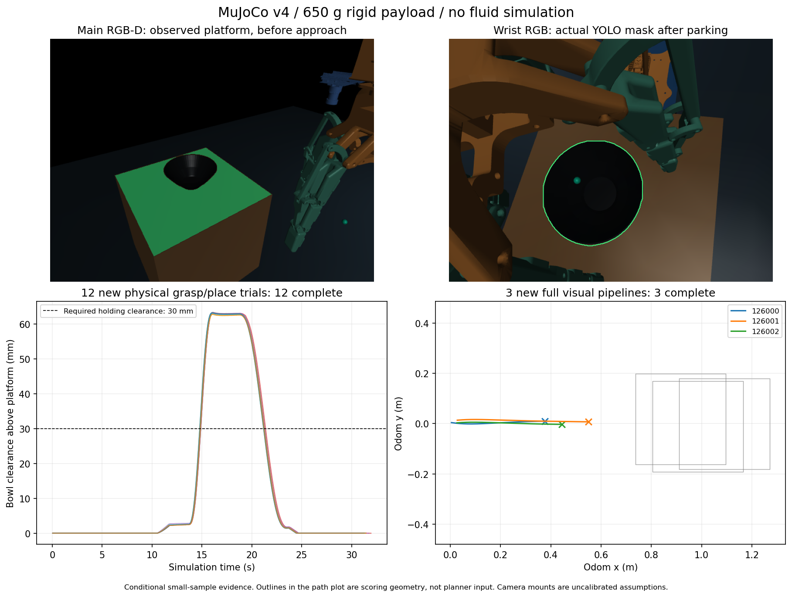

# 同步四爪抓650g水碗：v4本地修复与验证

2026-11-19。结论：在本轮明确的仿真假设下，新的机械臂随机场景12/12完成抓放；更换位置后的完整视觉接近场景3/3完成。可以交给Mac做更大样本验收和有门槛的训练，但这些小样本尚不能证明总体或实机成功率≥95%。

## 本轮修复

- 按用户STEP销轴重建32铰链、12闭环连接、一个公共滑架执行器，保留被动自由度；撤销将各指节角度直接写成公共行程函数的错误假设。四爪仍共用一个开合命令，650g碗仍为自由刚体。
- 硬指节/连杆使用离线CoACD凸分解，泡沫单独建模。碗壁由16片改成64片，减少多边形轮廓侵入接触间隙的问题。凸分解仍有近似误差，不能当精确CAD接触。
- 公共闭爪允许有限的先接触让位和追加行程；对向实际承载充分且连续后才确认，代替“第一片泡沫一碰就冻结”。原始力越界直接停，不被滤波掩盖；放置时首次触台停降、清延迟队列、撤预载，连续承托充分后才松爪。
- 抓放保持工具完整朝向，修复冗余轴自转；IK使用协调步长、回溯和有界最小二乘，保持原有可达误差要求。观察姿态到抓取姿态采用独立求出的home分支，关节命令仍连续限速运动。
- 独立小模型复现了MuJoCo3.3.7圆柱碗底几乎贴平台时误报约20cm穿透的问题。将半径30mm、高6mm碗底改成96边凸网格，径向近似误差<17µm，支撑碰撞保留，并增加浅接触回归检查。
- 主摄改为侧上方候选安装点，从实际RGB-D提取平台；接近时有限更新观测地图。停车候选把搜索中心放在臂坐标X=215/220/225mm处，兼顾车辆避碰和未知碗偏移；不改变车体尺寸。腕摄以45mm支架偏移、−12°候选角度和有限整臂观察姿态寻找碗。它仍在servo004上游，旋转004不会让相机转动。

保留离台至少30mm、保持2秒、倾斜≤0.2rad、放回误差≤10mm、真实承托与松爪后连续稳定0.5秒的完成标准。没有焊接碗、降低载荷、增加独立手指电机或删除硬指节碰撞。

## 实测与分母

| 检查 | 结果 | 用途与证据 |
| --- | --- | --- |
| 用户回传的三种动力学抓取变体 | 各0/40 | 原始失败证据，见原ZIP及 `audit/independent-audit.json` |
| 开发轮27：新停车场景 | 8/12 | 4次IK数值失败；保留在iteration-summaries与logs |
| 开发轮28：新停车场景 | 11/12 | 1次圆柱碗底异常接触；没有以放宽力阈值计成功 |
| 修复后复测原失败97010 | 1/1 | 回归案例，不计入新场景成功率 |
| 固定物理版本后的新场景99800–99811 | **12/12** | `release-baseline12/` 完整episode、20Hz trace、状态回放和源文件哈希 |
| 步长减半、碗96片、最低摩擦、被动弹性±20% | **5/5探针** | 每个因素1例，见 `sensitivity-final/`，不合并成成功率 |
| 视觉开发失败123000–123002 | 0/3 | 平台遮挡、停车后不可达与观察姿态衔接失败；原失败保留 |
| 修复后同三例重测 | **3/3** | 开发回归，不是新盲测，见 `camera-development/full-pipeline-repair4/` |
| 新视觉场景126000–126002 | **3/3** | 平台定位、连续开车、停车、真实YOLO腕定位、物理抓放均完成，见 `camera-holdout3/` |
| 完整测试套件 | **128项通过** | `audit/tests-release-final.log` |
| 后增初始观测记录回归及关联检查 | **16项通过** | 其中15项与完整套件重叠；见 `audit/tests-final-sensor-provenance.log`，不能相加成144个不同测试 |

12/12的Wilson95%区间约75.7%–100%；3/3约43.8%–100%。本地复测和开发中出现的失败不会从各自分母删除，也不会把多轮调参中的成功拼成一个盲测成绩。

12个机械臂场景的最大最终放置误差约0.384mm，最大闭环销轴分离约0.481mm，均为本模型的状态评分，不能当作真实视觉或机器人定位精度。源码中的1mm闭环误差守卫仍生效。

## 效率和可复核性

借鉴 [Reuleaux](https://github.com/ros-industrial-attic/reuleaux)、[robosuite](https://github.com/ARISE-Initiative/robosuite) 和 [Mink](https://github.com/kevinzakka/mink) 的可达性选位、组件控制、整臂视线和运动约束思路；具体采用范围见 `../docs/开源项目借鉴与取舍.md`。没有把其他机器人的夹爪、参数、成功率或预训练策略套到本车。

按照MuJoCo官方雅可比接口要求，私有IK数据只运行运动学与comPos。32组姿态的位姿和雅可比与完整forward逐元素一致；99800完整抓放的628帧qpos/qvel/ctrl回放也完全一致。300次私有计算的小测速约17.6倍加速，这不代表整套仿真或训练快17.6倍。碰撞筛选和真实物理步进继续使用完整流程。

原始12例保留优化前固定源码哈希；优化等价性见 `audit/ik-optimization-equivalence.json`。随后仅修正initial_target_error记录，避免重新定位后的估计覆盖“初始场景”字段，并将Mac工作流的开发/验证种子与指南对齐；这些改动不用于伪造旧结果的源文件哈希。本地证据不直接准入Mac大训练，Mac会重新跑本轮源码、模型与配置一致的新样本。

回传打包工具已实际生成ZIP并完成CRC/内容哈希自检，见 `audit/collect-return-test.log`。离线Python与60个wheel在构建交付包时再次校验来源记录、SHA256、CRC、目标架构和依赖闭包；没有在Linux运行Mac二进制。

## 适用范围与Mac下一步

机械臂独立训练使用带噪位姿观测，并在闭爪前平均24次新观测；这是视觉定位接口契约，不是RGB精度测试。完整视觉场景使用真实分割网络输出，腕摄结果冻结交接，不以碗真值兜底。主摄平台检测是带显式尺寸/朝向先验的深度几何算法，尚不是语义平台识别网络。

执行器力/延迟、泡沫摩擦压缩、被动关节弹性阻尼、质量惯量、相机安装及车辆尺寸仍有未实测参数。真实塑料柔性、水晃动和整车颠簸没有建模，650g仅作为刚体总质量。当前车辆是前轮转向运动学模型，停稳后交接机械臂接触动力学。真实主摄若无深度，定位方案还需适配。

Mac用新开发100例和新验证200例，机械臂观察成功率各≥95%、无严重接触/碰撞/数值异常且测试/指纹一致后，才启动2万步，再按结果决定是否累计约10万步；CPU/MPS在Mac实测选择。新移动20例单独验收，114000–114199保留作最终盲测。若PPO没有超过可靠基线，保留基线控制器。完整命令见 `../Mac训练与视觉抓放v4指南.md`。
